<div align="center">

# ARENA GRAPHICS

**Mesin grafis broadcast Mobile Legends: Bang Bang (MLBB) — local-first, transparan, siap OBS.**

Overlay HTML 1920×1080 dengan latar transparan, dikendalikan dari satu dashboard operator.
Dibangun dengan TypeScript, Fastify + Socket.IO, React + Vite, SQLite, dan OBS WebSocket.

<sub>Node.js ≥ 22.12 · pnpm ≥ 10 · Windows 10/11</sub>

[](https://github.com/zann06/arena-graphics/actions/workflows/ci.yml)
[](https://zann06.github.io/arena-graphics/)

</div>

---

## Demo

> 🌐 **Showcase online:** <https://zann06.github.io/arena-graphics/> — galeri lengkap overlay & dashboard.

### Overlay on-air

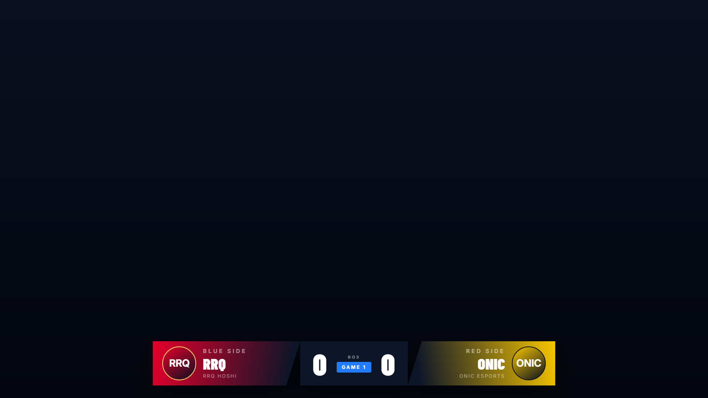
*Scoreboard — skor seri, format BO, warna tim dari data tim.*

| Draft | Statistics |
|---|---|
| 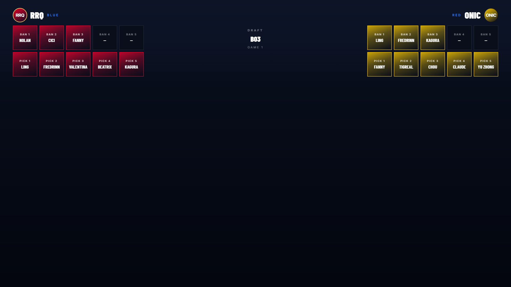 | 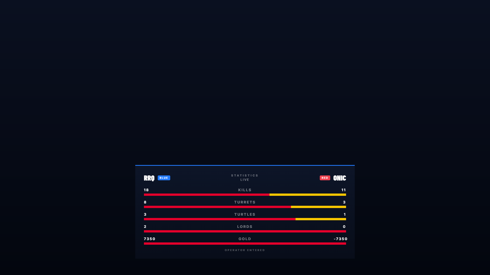 |

| Player intro | Team intro |
|---|---|
| 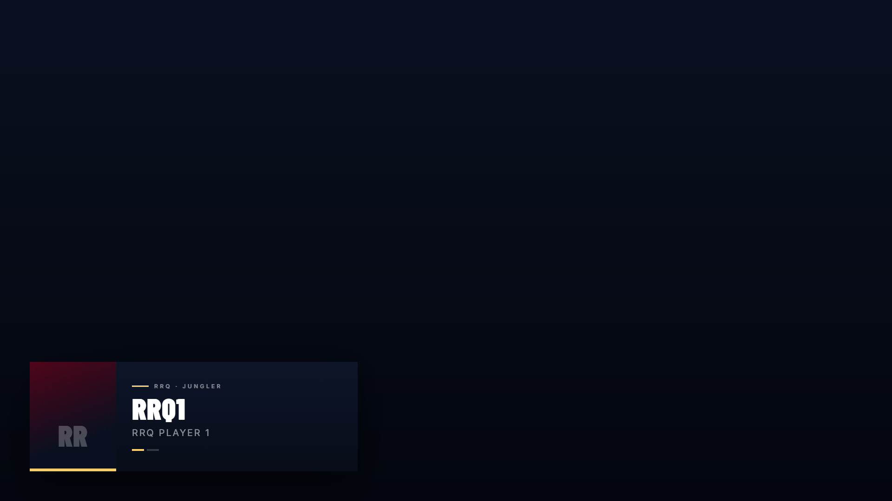 | 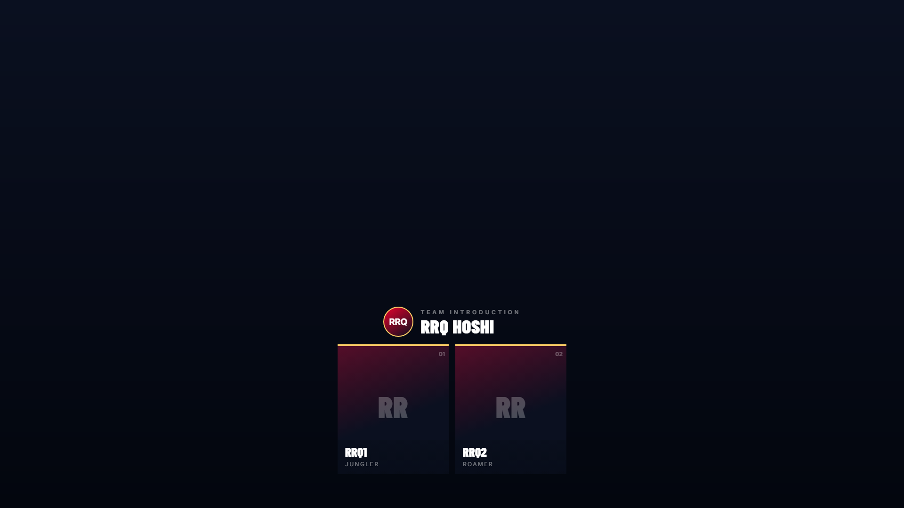 |

| MVP | Fullscreen |
|---|---|
| 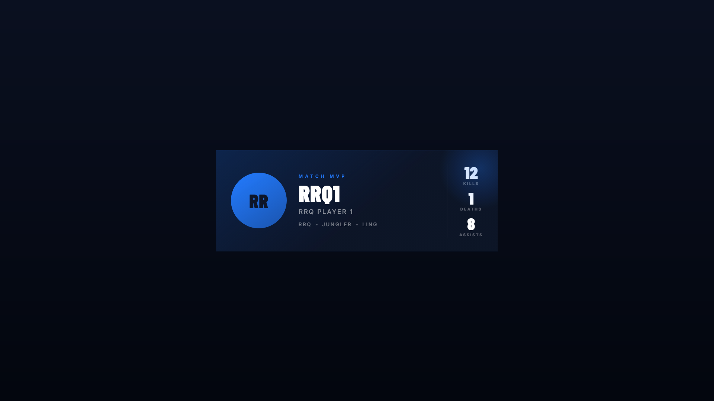 | 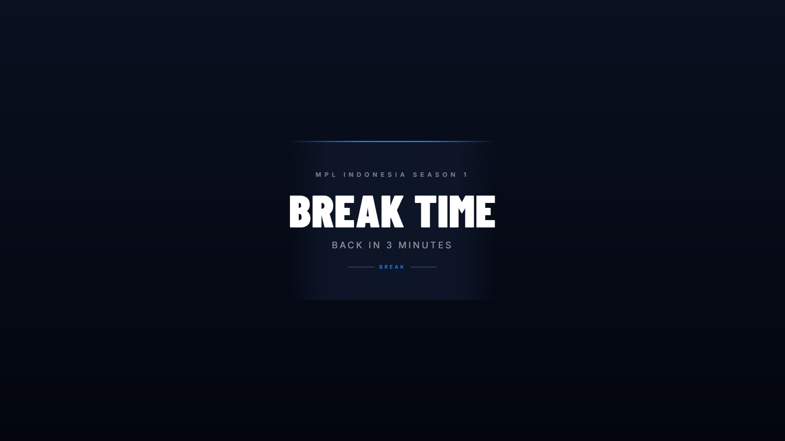 |

> Semua overlay di atas adalah capture nyata dari aplikasi, dirender 1920×1080 dengan
> background transparan (alpha = 0) lalu ditempel ke latar gelap agar terlihat jelas di sini.
> Di OBS, background transparan inilah yang membuat grafis menyatu dengan gameplay.

### Dashboard operator

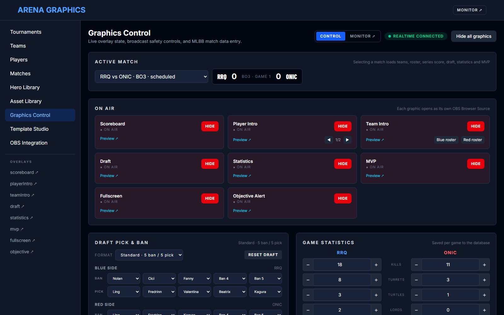

| Template Studio | Asset Library |
|---|---|
| 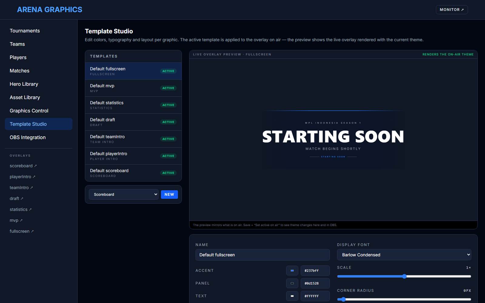 | 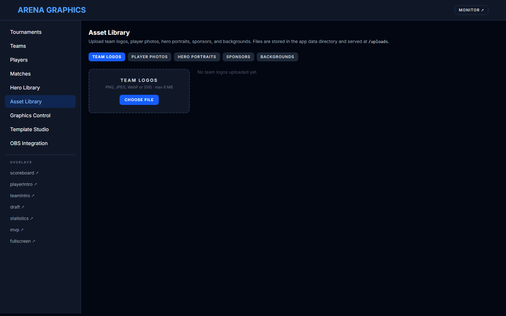 |

| Matches | OBS Integration |
|---|---|
| 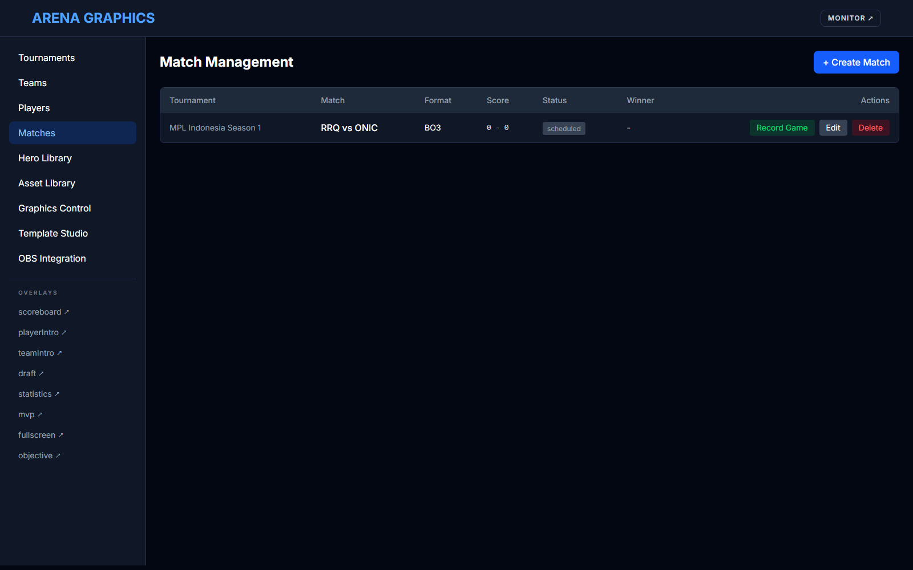 | 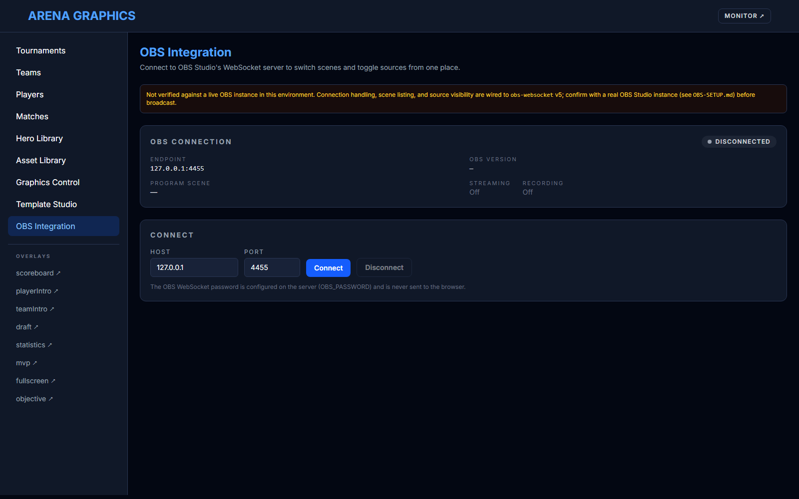 |

| Hero Library | Monitor |
|---|---|
| 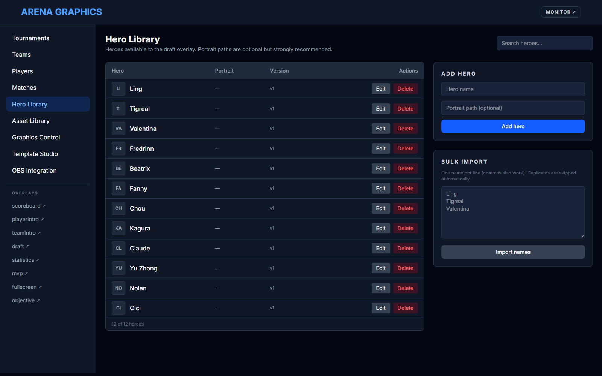 | 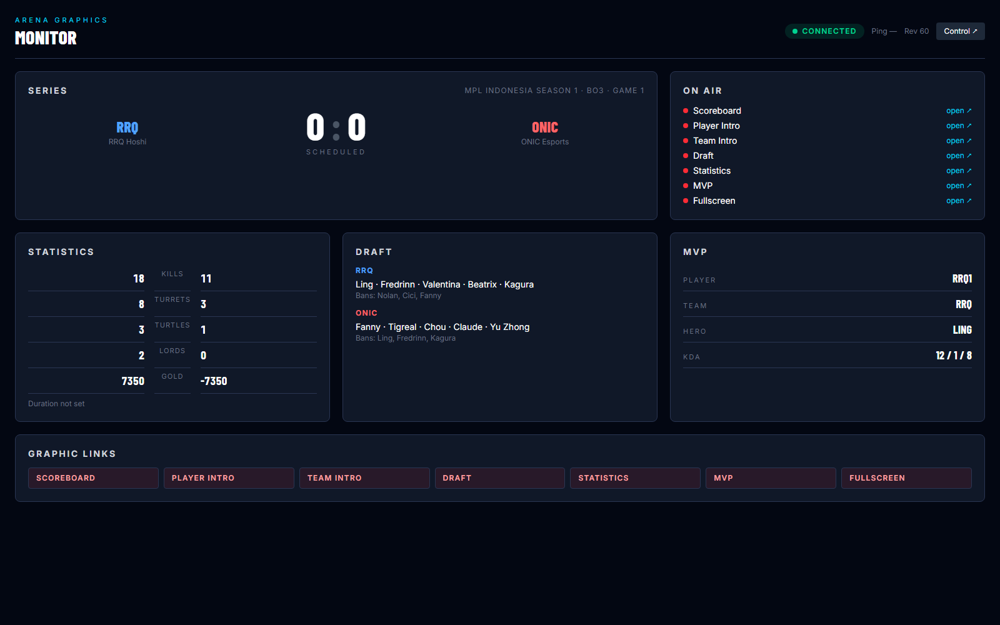 |

---

## Fitur

- **Manajemen turnamen** — turnamen, tim, pemain, match (BO1/BO3/BO5), pencatatan hasil game, dan skor seri otomatis dari game yang selesai.
- **Grafis MLBB** — library hero, draft konfigurabel (5-ban/5-pick atau 3-ban/5-pick) tersimpan per game, statistik per game, dan MVP dengan KDA.
- **7 overlay siap siaran** — scoreboard, player intro, team intro, draft, statistics, MVP, fullscreen (starting soon / break / result). Semua transparan 1920×1080.
- **Graphics Control** — satu halaman untuk menaruh grafis on-air, memajukan player intro, dan reset.
- **Asset Library** — upload logo tim, foto pemain, portrait hero, sponsor, dan background (PNG/JPEG/WebP/GIF/SVG, maks 8 MB).
- **Template Studio** — tema per grafis (warna, tipografi, skala, radius, accent bar), duplikat/reset/aktifkan, dengan preview overlay live. Tema aktif langsung berlaku on-air.
- **OBS Integration** — koneksi WebSocket, ganti scene, toggle visibility source. *(Adapter terverifikasi dengan mock — konfirmasi ke OBS nyata sebelum siaran.)*
- **Realtime & recovery** — state disiarkan lewat Socket.IO; overlay dan dashboard pulih otomatis setelah reconnect.

---

## Cara pakai

### 1. Prasyarat

- **Node.js ≥ 22.12** — <https://nodejs.org>
- **pnpm ≥ 10** — `npm install -g pnpm@10`
- **OBS Studio** (untuk siaran) — <https://obsproject.com>
- **Microsoft Edge** (hanya jika ingin menjalankan skrip screenshot/demo)

### 2. Instalasi

```powershell
git clone https://github.com/zann06/arena-graphics.git
cd arena-graphics

# Satu kali: cek toolchain, install dependency, buat .env, migrasi database.
pnpm setup
```

Ingin data demo langsung? Seed turnamen contoh:

```powershell
pnpm setup -Seed
```

### 3. Jalankan

```powershell
# Mode development (server :4000 + dashboard :5173 dengan live reload)
pnpm dev
```

Buka:

| URL | Fungsi |
|---|---|
| <http://localhost:5173> | Dashboard operator (dev) |
| <http://localhost:4000> | Dashboard yang sama dari build produksi |
| <http://localhost:4000/overlay/scoreboard> | URL overlay untuk Browser Source OBS |

### 4. Mode produksi

```powershell
pnpm build                      # build server + web
node scripts/start-server.mjs   # jalankan di 127.0.0.1:4000
node scripts/start-server.mjs --stop
```

Build SPA disajikan oleh server API, jadi satu origin melayani dashboard, REST API,
Socket.IO, dan asset `/uploads/*`.

### 5. Pasang overlay di OBS

1. Di OBS: **Sources → + → Browser**.
2. Isi **URL** dengan salah satu overlay, contoh `http://127.0.0.1:4000/overlay/scoreboard`.
3. Set **Width = 1920**, **Height = 1080**.
4. Centang **Shutdown source when not visible** agar hemat resource.
5. Ulangi untuk overlay lain (`player-intro`, `team-intro`, `draft`, `statistics`, `mvp`, `fullscreen`).

Panduan lengkap (layer order, WebSocket, troubleshooting, checklist siaran) ada di
**[docs/OBS-SETUP.md](docs/OBS-SETUP.md)**.

### 6. Konfigurasi

Salin `.env.example` → `.env` dan sesuaikan bila perlu. `.env` sudah di-gitignore.

| Variabel | Default | Fungsi |
|---|---|---|
| `HOST` | `127.0.0.1` | Alamat bind (local-only). |
| `PORT` | `4000` | Port API/overlay. |
| `WEB_ORIGIN` | `http://localhost:5173` | Origin CORS untuk dev server. |
| `LOG_LEVEL` | `info` | `fatal…trace`. |
| `ARENA_DATA_DIR` | `%LOCALAPPDATA%\ArenaGraphics` (atau `<workspace>/data`) | Root database SQLite + asset upload. |
| `DATABASE_URL` | `file:.../arena.sqlite` | URL SQLite/libSQL. |
| `OBS_HOST` / `OBS_PORT` | `127.0.0.1` / `4455` | Endpoint OBS WebSocket. |
| `OBS_PASSWORD` | _(kosong)_ | Password OBS WebSocket — **hanya di server, tidak pernah dikirim ke browser**. |
| `OBS_AUTO_CONNECT` | `false` | Sambung ke OBS saat server start. |

---

## Testing & verifikasi

```powershell
pnpm typecheck      # TypeScript di semua package
pnpm lint           # ESLint (0 warning)
pnpm test:unit      # Vitest unit test (graphics-core)
pnpm build          # build produksi
```

Cek integrasi + overlay membutuhkan server berjalan di `:4000`:

```powershell
node scripts/start-server.mjs
pnpm test:integration   # state recovery, MLBB, templates/assets, OBS mock,
                        # capture overlay, transparansi + 1920×1080
node scripts/start-server.mjs --stop
```

Atau jalankan semuanya sekaligus (server otomatis dinyalakan/dimatikan):

```powershell
pnpm verify     # typecheck → lint → unit → build → integrasi + overlay
```

| Perintah | Yang dicek |
|---|---|
| `pnpm test:obs` | Adapter OBS terhadap mock obs-websocket (17 cek). |
| `pnpm test:templates` | CRUD template + upload/list/delete asset (17 cek). |
| `pnpm test:overlays` | Capture overlay draft / statistics / MVP 1920×1080. |
| `pnpm test:transparency` | PNG overlay punya alpha channel & sudut transparan. |
| `node scripts/demo-screenshots.mjs` | Regenerasi semua screenshot di `docs/screenshots/`. |

---

## Struktur proyek

```text
apps/
  server/           Fastify API, Socket.IO, Drizzle/SQLite, adapter OBS, storage asset
  web/              Dashboard React + renderer overlay (Vite)
packages/
  shared/           tipe & konstanta bersama (realtime, template, canvas)
  graphics-core/    helper scaling/animasi (ber-unit-test)
scripts/            setup, verify, start-server, smoke test, screenshot CDP
docs/
  screenshots/      gambar demo untuk README & situs showcase
site/               halaman showcase (GitHub Pages)
```

---

## Dokumentasi

Demo lengkap & showcase ada di **<https://zann06.github.io/arena-graphics/>**.

- [PRD](docs/PRD.md) — visi produk, fitur, kriteria penerimaan.
- [Arsitektur](docs/ARCHITECTURE.md) — arsitektur, alur data, protokol.
- [OBS Setup](docs/OBS-SETUP.md) — panduan OBS Studio & checklist siaran.

---

## Batasan yang diketahui

- Integrasi OBS WebSocket **belum diverifikasi dengan instance OBS Studio nyata** di
  lingkungan pengembangan ini — verifikasi ganti scene & visibility source sebelum siaran.
- Aplikasi ditujukan untuk satu operator, satu mesin, dan bind ke `127.0.0.1` (local-only).
- Asset upload dan database SQLite berada di data directory dan tidak masuk source control.

---

<div align="center">
<sub>Dibuat untuk komunitas esports MLBB. Silakan fork, modifikasi, dan kontribusi.</sub>
</div>
